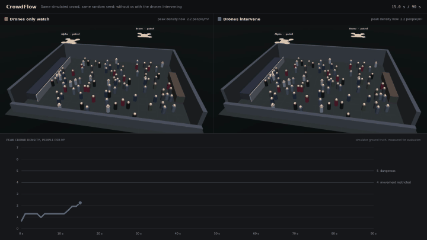
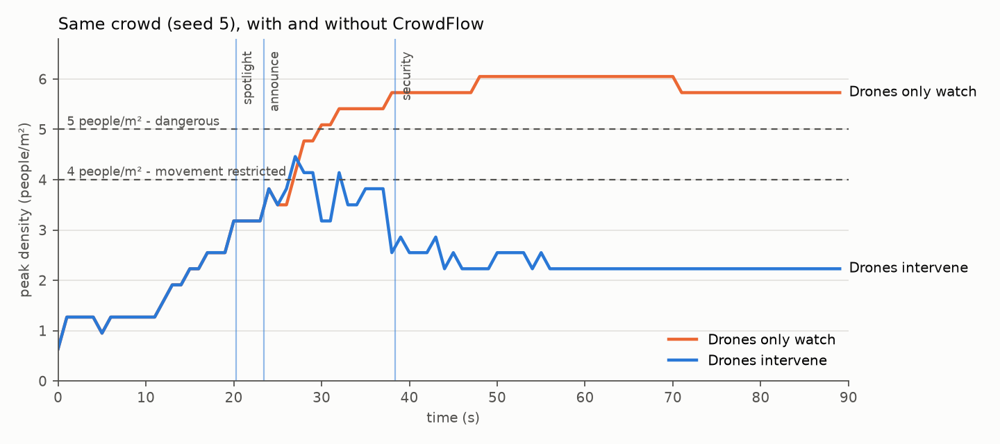
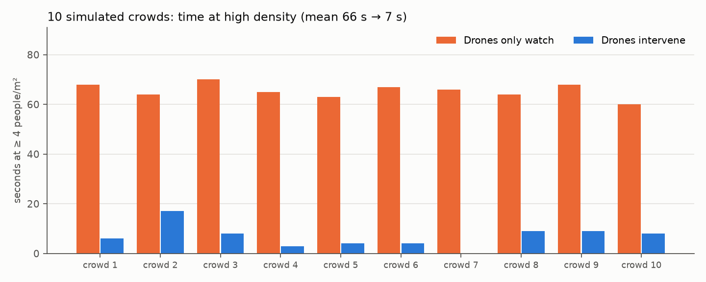
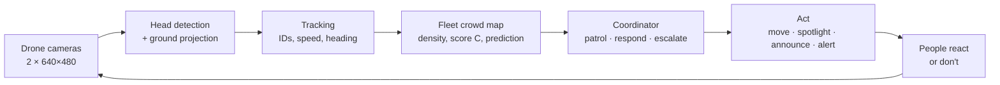

# CrowdFlow — drones that spot a crowd crush forming, and act before it does

Two camera drones watch a 100-person concert floor in simulation. They notice when the area in front of
the stage is becoming dangerously packed, and try to **prevent** a crush with escalating, non-physical
interventions: a red spotlight, a spoken announcement, and finally an alert to the security team.



*Same simulated crowd, same random seed. Left: drones only watch. Right: drones intervene. The chart
underneath is the true peak density in both runs.*

> **Simulation prototype for decision support.** Not a validated crowd-safety system. The drones never
> touch, push or herd anyone, and humans stay in charge.

## Results

Across **10 randomised crowds** (90 s each), the same scenario run with the drones only watching versus
intervening:

| | Drones only watch | Drones intervene |
|---|---|---|
| Time at **≥ 5 people/m²** (dangerous), mean | 60.4 s | **0.1 s** |
| Time at **≥ 4 people/m²** (movement restricted), mean | 65.5 s | **6.8 s** (−90%) |
| Crowds that ever reached 5 people/m² | 10 / 10 | **1 / 10** (for 1 s) |
| Mean peak density | 6.05 people/m² | **4.64 people/m²** |

<p>
  
  
</p>

**How it got there.** The first version only reacted once an area was already crowded. Adding a short-range
prediction (see below) moved the first alert earlier (21.3 s → 18.6 s on average) and cut the number of
crowds that reached 5 people/m² from 4/10 to 1/10 (a promising sign, though 10 crowds is too few to
prove that difference). Both evaluations are in `results/`.

**How to read these numbers.** Densities are measured *after* each run from simulator ground truth (most
people inside any 1 m-radius circle); the drones never see ground truth. Crowd-safety guidance commonly
treats sustained densities above ~5 people/m² as dangerous. The crowd model is stylised, so this shows the
system works **in this simulation**, not in a real venue. Exact numbers vary slightly between machines.

## The scenario

* **Venue:** a 20 m × 15 m indoor floor, stage on the west wall behind a barrier, bar on the east wall.
  100 people average ~0.37 people/m², but the strip in front of the stage centre is only a few m².
* **People:** 60 fans, 28 casual attendees and 12 people moving to and from the bar. Each fan decides
  *at a random time* to head for the centre of the stage barrier, and keeps pressing forward once there.
* **Nothing is scripted.** Congestion emerges because many people want the same few square metres.

## How it works

Every 0.1 s, the loop runs perception → decision → action, and the cameras then see the result:



1. **Perception** (`perception/density_detector.py`): each drone's downward camera is segmented for
   heads. In a dense crowd bodies merge into one blob but heads stay separate, so counting stays reliable.
   Heads are projected onto the floor using the drone's pose. Measured against ground truth over 2,343
   heads: 100% recall, 99.9% precision, 2 cm median position error.
2. **Tracking** (`perception/tracker.py`): detections are linked across frames (Hungarian matching,
   0.4 m gate), giving each person a temporary ID, a speed and a heading.
3. **Fleet crowd map** (`perception/zone_analytics.py`): both drones' tracks are fused into overlapping
   2 m × 2 m zones. Each zone gets density, speed, growth, share stopped and flow direction, combined into
   a **congestion score C** (0–100: NORMAL / DEVELOPING / HIGH / CRITICAL). Areas no drone can currently
   see are *unknown*, never "empty".
4. **Early warning:** each zone also predicts its density 10/20/30 s ahead from two signals, and takes the
   higher: the trend over the last 30 s, and the people currently *walking towards* it. The second catches
   a wave of fans heading for the stage before the density itself rises.
5. **Coordinator** (`brain/fleet_planner.py`): Alpha patrols the stage half and Bravo the bar half at 7 m.
   When a zone is developing, or predicted to become dense, the nearer drone descends to 5.5 m over it and
   the other repositions to keep the stage front in view. Then it escalates step by step:

| Step | When | What happens |
|---|---|---|
| 0 Monitor | an area is developing, or heading for ≥ 3.5 people/m² in 20 s | a drone moves in to look closer |
| 1 Spotlight | the area is HIGH, filling up, or heading for ≥ 3.5 | a red spotlight marks the area |
| 2 Announce | still HIGH, CRITICAL, or heading for ≥ 4 | "please make space at the front", naming side areas the drones **can see** are free; repeated if nothing improves |
| 3 Security | only if density is **not falling** well after the announcement | notify the security team (a notification only) |
| Resolved | below HIGH for 8 s | spotlight off, back to patrol |

6. **People's response** (`sim/drone_env.py`): the spotlight and announcement only change what people
   know. Each person has their own responsiveness (35–90%) and reaction delay (1–8 s). People in the
   spotlight may stop pushing forward; people who follow an announcement walk to the nearest named side
   area and stop early if it is already busy.

**A lesson built into the design:** an early version sent everyone to one side area, which simply became the
next hotspot. The coordinator now spreads people over several observed, uncrowded areas.

<details>
<summary>Score details and adaptations for a standing audience</summary>

`C = 100 × (0.25·density + 0.20·speed drop + 0.20·growth + 0.15·share stopped + 0.10·direction mix + 0.10·duration)`,
with unavailable terms dropped and the weights renormalised.

The score was designed for walking flows. At a concert, standing still at 1–2 people/m² is normal, so:
speed, stopping and direction terms are scaled by `clamp((ρ − 2.0) / 1.5, 0, 1)`; growth by
`clamp(ρ − 1.0, 0, 1)`; and the critical override uses ρ ≥ 3.0. All thresholds and weights are prototype
choices, not validated safety limits.
</details>

## Run it

Requires Python 3.9+. On macOS this works out of the box; on a headless Linux machine set `MUJOCO_GL=egl`.

```bash
pip install -r requirements.txt

python run_simulation.py                       # one 90 s run -> submission_video.mp4 (1920×1080) + run_summary.json
python run_simulation.py --no-interventions    # baseline: drones only watch
python evaluate.py --seeds 10 --workers 4      # many crowds, on vs off -> results/evaluation.json
python plot_results.py                         # plots from the evaluation -> results/*.png
python side_by_side.py --clip 15 50 --gif      # comparison video + short clip and GIF
```

Useful options for `run_simulation.py`: `--seed`, `--duration`, `--fps` (multiple of 10), `--no-video`
(numbers only, faster, identical results), `--no-cards` (skip the title and results cards), `--quiet`,
`--camera-fault` (corrupts Alpha's camera at 70–74 s to show the failsafe: spotlight off, climb to 8 m
and hold).

The single-run video (1920×1080) opens with a title card and ends with that run's results. In between it
shows the venue overview with the drones labelled by role, the active drone's camera (tracked people,
with those stopped for 3 s+ highlighted), the fleet crowd map, the escalation steps, the hotspot's
measurements and the operator log. All drawing lives in `viz/hud.py`, so both videos share one style.

## Repository

```text
config/generate_arena.py   venue, 100 pedestrians, 2 drones -> config/arena.xml (generated)
sim/drone_env.py           physics, crowd behaviour, response to the drones, ground-truth evaluation
perception/                head detector, tracker, fleet crowd map, score C and prediction
brain/fleet_planner.py     patrol, responder/overwatch roles, escalation ladder, failsafe
run_simulation.py          main loop, video + operator panel, per-run summary
evaluate.py                multi-crowd comparison: drones intervening vs only watching
plot_results.py            timeline and per-crowd plots from evaluate.py results
side_by_side.py            comparison video (same crowd, without vs with drones) + clip/GIF
viz/hud.py                 shared video style: fonts, colours, layout helpers, title and results cards
results/                   evaluation results and plots used in this README
run_all.py, docs/          the original hackathon demo and its pitch notes (earlier 18-person version)
```

## Limitations

* **Simulation only:** simple cylinder pedestrians, stylised pushing and compliance, one indoor venue,
  one scenario.
* **Perception shortcut:** every head shares one skin tone in the simulator, which no clothing or surface
  uses. A real system would need a learned person detector (e.g. YOLO), which is the next planned step.
* **Over-cautious escalation:** security is still alerted in 7 of 10 crowds. In a real venue an alert that
  almost always fires would soon be ignored.
* **Not modelled:** battery life, whether the drone speaker is audible over concert audio, wind, lighting,
  and the safety of flying over people.
* Latency figures printed by the scripts are from the machine they run on, not from drone hardware.

## Credits

CrowdFlow started as a team project at a hackathon in November 2026. This version of the simulation,
perception, decision logic and evaluation was rebuilt afterwards, keeping the team's core idea of
venue-wide congestion monitoring by drones.
